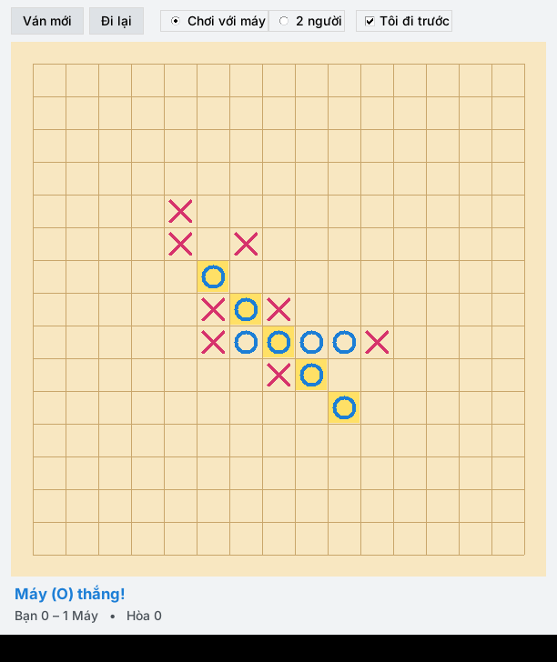

# Cờ Caro

Phần mềm chơi cờ caro (gomoku) trên máy tính, viết bằng Python + Tkinter — chạy thành cửa sổ riêng, không cần trình duyệt.

## Chạy

```
python caro.py
```

- Windows / macOS: chỉ cần cài Python 3 (đã có sẵn Tkinter).
- Ubuntu / Debian: `sudo apt install python3-tk` rồi `python3 caro.py`.

## Tính năng

- Bàn cờ 15×15, ai xếp được 5 quân liên tiếp (ngang, dọc, chéo) trước là thắng.
- Chơi với máy hoặc 2 người chung một máy; chọn đi trước hay đi sau.
- Đi lại (Ctrl+Z), ván mới (F2), tô sáng nước vừa đi và đường thắng, đếm tỉ số.


